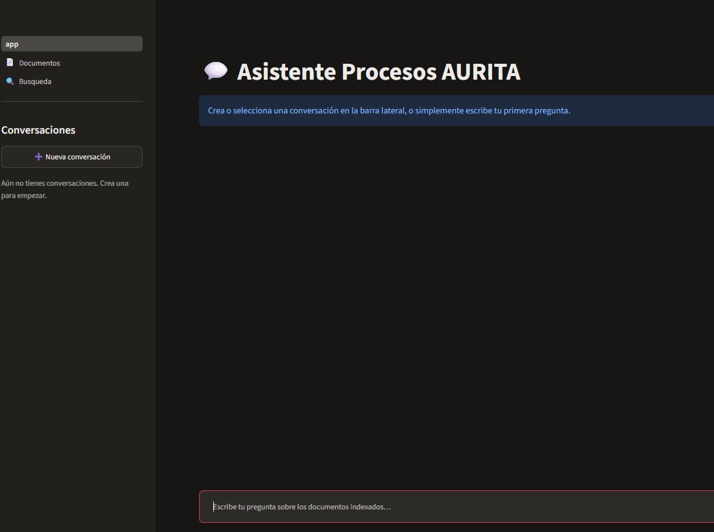

# Asistente documental (RAG) — Streamlit + LangChain + Qdrant + SQLite

Chatbot documental: responde preguntas basándose en documentos indexados en Qdrant,
mantiene conversaciones persistentes en SQLite y genera respuestas en streaming con
LangChain + Groq.



## Arquitectura

```
app.py                      # Página principal: chat (REQ-001, 002, 003, 004, 008, 009)
pages/
  1_📄_Documentos.py         # Carga, listado y borrado de documentos (REQ-005, 006, 009)
  2_🔍_Busqueda.py           # Prueba de búsqueda semántica (REQ-007)
src/
  config.py                 # Toda la configuración (.env) en un único lugar
  db/                        # SQLite: esquema y CRUD de conversaciones/mensajes/documentos
  vectorstore/               # Cliente Qdrant (bajo nivel) + embeddings E5
  ingestion/                 # Carga/validación de archivos, chunking, pipeline de indexado
  rag/                        # Reformulación de preguntas, recuperación y generación en streaming
  ui/                         # Identidad de propietario, gate de admin, componentes de chat
tests/                       # Pytest: SQLite, chunking, validación de documentos (sin red)
```

### Por qué no se usa el `VectorStore` de LangChain para Qdrant

La colección existente usa un esquema específico: vector nombrado `text`, el texto del
fragmento en el campo `contenido` y metadatos **planos** (no anidados bajo `metadata`).
El wrapper `QdrantVectorStore` de LangChain impone sus propias convenciones de payload
(`page_content` / `metadata` anidada), lo que rompería la compatibilidad al reutilizar
la colección actual. Por eso `src/vectorstore/qdrant_client.py` usa `qdrant-client`
directamente, controlando el payload exactamente como se requiere. LangChain sí se usa
para los prompts y la generación en streaming con Groq (`src/rag/chain.py`).

### Embeddings

Modelo: `intfloat/multilingual-e5-small` (384 dimensiones, distancia coseno).

**Importante:** los modelos E5 requieren anteponer `"query: "` a las consultas y
`"passage: "` a los textos indexados (`src/vectorstore/embeddings.py`). Si cambias de
modelo o de estrategia de preparación del texto, los vectores dejan de ser comparables
aunque la dimensión coincida — en ese caso crea una colección nueva y reindexa; no
reutilices la colección actual con un modelo distinto.

### Esquema SQLite

| Entidad          | Campos                                                                                                     |
| ---------------- | ---------------------------------------------------------------------------------------------------------- |
| `conversaciones` | `id, titulo, propietario_id, creada_en, actualizada_en`                                                    |
| `mensajes`       | `id, conversacion_id, orden, rol, contenido, estado, creado_en, metadata_json`                             |
| `documentos`     | `id, nombre_archivo, tipo, tamano_bytes, propietario_id, estado, num_fragmentos, error_detalle, creado_en` |

`metadata_json` guarda, para respuestas de asistente, las fuentes recuperadas, sus
puntuaciones y el modelo usado. `st.session_state` solo se usa para estado efímero de
interfaz (conversación seleccionada, formularios abiertos); SQLite es la fuente de
verdad persistente.

### Flujo de una pregunta

1. Se guarda el mensaje del usuario en SQLite.
2. Se lee una ventana reciente de mensajes (no todo el historial) de esa conversación.
3. Si hay historial, se reformula la pregunta con el LLM para resolver referencias
   dependientes del contexto (p. ej. "¿y cuánto cuesta?").
4. Se recupera contexto en Qdrant con la pregunta reformulada.
5. Se genera la respuesta en streaming con LangChain + Groq, usando solo el contexto
   recuperado. Si no hay fragmentos por encima del umbral, se informa explícitamente
   que no hay evidencia suficiente, sin llamar al LLM.
6. Se guarda la respuesta final junto con sus fuentes; cualquier fallo (Qdrant, Groq)
   se captura y se guarda como mensaje con `estado = 'error'`, mostrado como tal en la UI.

### Separación por propietario y administración (REQ-009)

Cada sesión obtiene un `propietario_id` estable guardado en el parámetro `?u=` de la
URL (`src/ui/session.py`). Las conversaciones siempre se filtran por `propietario_id`.
La página de gestión de documentos se protege con `ADMIN_PASSWORD` (si no se configura,
queda abierta — pensado para un despliegue de un solo usuario/equipo de confianza).

> Limitación conocida: el identificador en la URL no sobrevive a un cambio de
> navegador/dispositivo ni a borrar la URL. Para multiusuario real con cuentas,
> sustituir `obtener_propietario_id()` por autenticación propiamente dicha.

## Configuración

```
cp .env.example .env
```

Variables clave (ver `.env.example` para la lista completa):

- `QDRANT_URL`, `QDRANT_API_KEY`, `QDRANT_COLLECTION`: conexión a la colección existente.
- `EMBEDDING_MODEL=intfloat/multilingual-e5-small`, `EMBEDDING_DIM=384`: deben coincidir
  con los usados al poblar la colección.
- `GROQ_API_KEY`, `GROQ_MODEL`: proveedor LLM.
- `SQLITE_PATH`: ruta del archivo de historial.
- `ADMIN_PASSWORD`: protege `pages/1_📄_Documentos.py`.
- `UPSERT_BATCH_SIZE=64`: tamaño de lote al indexar fragmentos.

## Instalación y ejecución

```powershell
python -m venv .venv
.\.venv\Scripts\python.exe -m pip install -r requirements.txt
.\.venv\Scripts\python.exe -m streamlit run app.py
```

> El primer uso descarga el modelo de embeddings desde Hugging Face: requiere acceso
> a internet saliente la primera vez (se cachea localmente después).

## Tests

```powershell
.\.venv\Scripts\python.exe -m pytest -q
```

Los tests cubren SQLite (conversaciones/mensajes, aislamiento por propietario),
chunking y validación de documentos (tipo, tamaño, contenido extraíble). No requieren
Qdrant ni Groq.

## Validación manual recomendada

- Reiniciar la app y confirmar que los mensajes y fuentes de conversaciones previas
  siguen disponibles.
- Abrir dos conversaciones y verificar que no comparten contexto ni historial.
- Indexar un documento en `Documentos` y preguntar algo que solo esté en ese documento.
- Eliminar el documento y confirmar que `Busqueda` ya no devuelve fragmentos suyos.
- Preguntar algo sin relación con los documentos indexados y verificar el mensaje de
  "no hay evidencia suficiente".
- Forzar un fallo (p. ej. `QDRANT_URL` inválido) y confirmar que el documento no queda
  marcado como indexado correctamente y que el chat muestra el error explícitamente.

## Segunda etapa (fuera de alcance de este MVP)

Herramientas de productos y tipo de cambio: no son necesarias para el chatbot
documental inicial: se pueden añadir como herramientas adicionales de LangChain sobre
esta misma base (conversaciones, historial y RAG) sin rediseñar la arquitectura.
